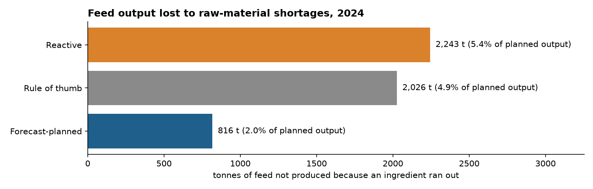
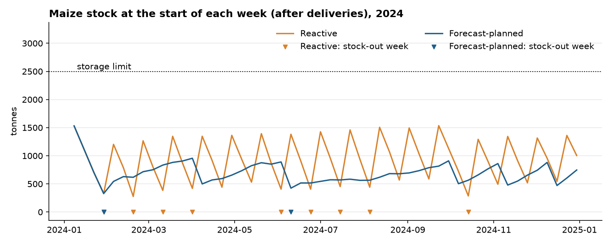
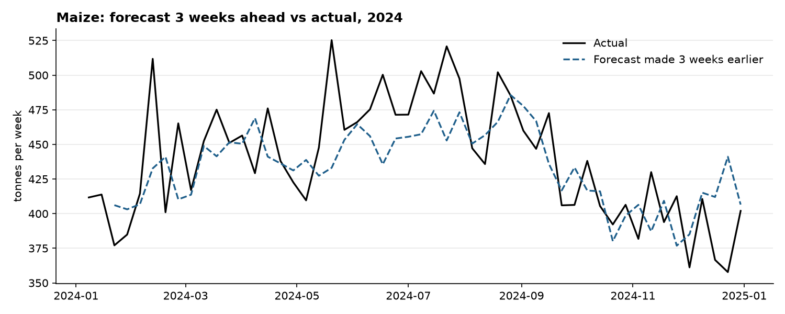

# Raw-Material Reorder Planner

**When should a feed mill order its raw materials, and how much, so production never stops for lack of an ingredient?**

This project forecasts weekly use of maize, soybean meal and wheat, then turns the forecast into purchase orders that respect supplier lead times, minimum order sizes and storage capacity. It tests three buying policies on a year the models never saw (2024).

**▶ [Try the interactive app](#)** · change lead times, storage space and service level and watch the plan respond.

## Results

| Over 2024 (held-out test year) | Reactive buying | Rule of thumb | **Forecast-planned** |
|---|---:|---:|---:|
| Feed output lost to ingredient shortages | 2,243 t (5.4%) | 2,026 t (4.9%) | **816 t (2.0%)** |
| Average value of raw-material stock held | $238k | $161k | **$159k** |

- **Forecasting plus safety stock cut lost output by 60%** compared with the rule of thumb, **while holding about the same amount of stock** ($159k against $161k on average). The gain comes from anticipating seasonal swings, not from buying more.
- **Compared with reactive buying, lost output fell 64% and average stock fell a third.** Reactive buying holds *more* stock yet still runs out, because it buys in big urgent batches only after stock already looks low.
- **Holt-Winters was the most accurate model for every material**: 2.6% to 3.5% error on total demand over the lead time, against 4.6% to 5.3% for a 4-week moving average and 6.1% to 7.3% for "same week last year".





The reactive line swings between big deliveries and near-empty silos; the planned line stays in a narrower band below the 2,500 t storage limit. Triangles mark weeks when stock could not cover that week's use.



## How it works

1. **Data.** Weekly consumption for a simulated mid-size mill (about 650 t of feed a week, growing 6% a year, with a yearly seasonal pattern and random noise) × each ingredient's share of the feed. Prices are **real** monthly World Bank prices (the "Pink Sheet") for maize, soybean meal and US hard red winter wheat, 2021 to 2024.
2. **Forecasts.** Four models (naive, 4-week moving average, seasonal naive, Holt-Winters exponential smoothing), refitted every week of 2024 using only data available at that point (rolling-origin backtest, no look-ahead).
3. **Accuracy.** Weekly MAPE, bias, and the metric a buyer actually depends on: error in **total demand over the lead time**.
4. **Ordering.** Every week the forecast-planned policy compares stock on hand plus stock on order with forecast use until the next order could arrive, plus safety stock sized from past forecast errors (95% service level). It orders the gap, rounded up to the supplier minimum, and never more than storage can hold when the delivery lands.
5. **Production impact.** A week's feed output is limited by whichever ingredient is scarcest.
6. **Order plan.** The model produces a dated plan for the 12 weeks after the data ends ([`order_plan_next_12_weeks.csv`](outputs/tables/order_plan_next_12_weeks.csv)).

| Policy | Rule |
|---|---|
| Reactive | When stock plus open orders covers less than 1.5 weeks, buy 3 weeks' worth from local traders on the spot market: 1-week delivery, 8% above market price. No forecast. |
| Rule of thumb | Cover the lead time + 1 week at the recent 4-week average. No safety stock. |
| Forecast-planned | Same check using the Holt-Winters forecast, plus safety stock and the storage limit. |

## Assumptions and limitations

- **Consumption is simulated**, not real company data. The seasonal pattern is built in, which suits Holt-Winters; real demand would also have promotions, disease outbreaks and one-off orders.
- Lead times (3 to 6 weeks), storage limits, minimum orders and the 8% spot premium are illustrative assumptions. They are all set in [`planner/config.py`](planner/config.py) and can be changed in the app.
- World Bank prices are international benchmarks, not local delivered prices. The model uses them to value stock and orders, not to time purchases.
- Each ingredient is simulated separately; in reality, a shortage of one would also reduce use of the others.

## Run it yourself

```bash
python -m venv .venv
.venv\Scripts\activate            # Windows  (macOS/Linux: source .venv/bin/activate)
pip install -r requirements.txt
streamlit run app.py              # the interactive app, using the saved results
python run_pipeline.py --fast     # rebuild tables and charts from saved forecasts
pip install pytest && pytest      # 8 tests: stock never negative, storage limit, lead-time timing, the app runs
```

To rebuild from scratch, download the [World Bank Pink Sheet monthly file](https://www.worldbank.org/en/research/commodity-markets) into `data/raw/CMO-Historical-Data-Monthly.xlsx` and run `python run_pipeline.py` (about 2 minutes).

```
planner/      config.py (assumptions) · data.py · forecast.py · inventory.py · pipeline.py
app.py        Streamlit app
run_pipeline.py
outputs/      figures/ and tables/ (accuracy, policy comparison, weekly simulations, order plan)
data/processed/   weekly consumption, weekly prices, saved rolling forecasts
tests/
```

## Why I built this

As an Operations Analyst at a poultry feed mill in 2025, I built Excel and Power BI tools that helped management move raw-material buying from reactive to planned. This project is a public rebuild of that problem in Python, with the pieces I would add next: measured forecast accuracy, safety stock, supplier minimums and storage capacity built into the ordering logic.

---
Prices: World Bank Commodity Price Data (The Pink Sheet), CC BY 4.0. Built by [Obaid Ullah Masood Raja](https://www.linkedin.com/in/obaidullah-masood-raja-225795218).
